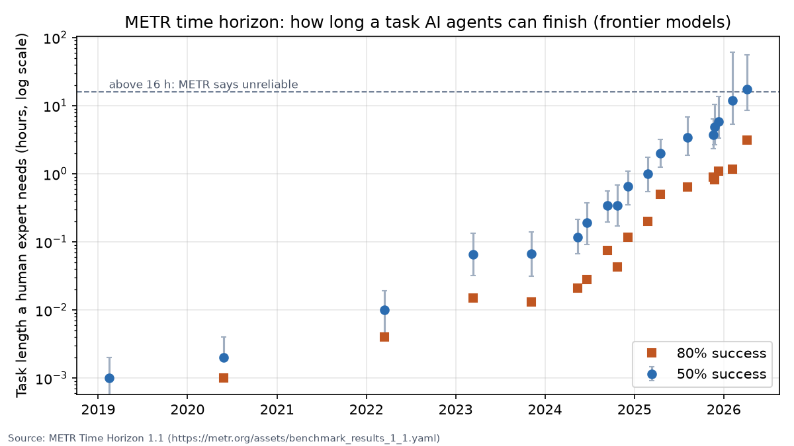
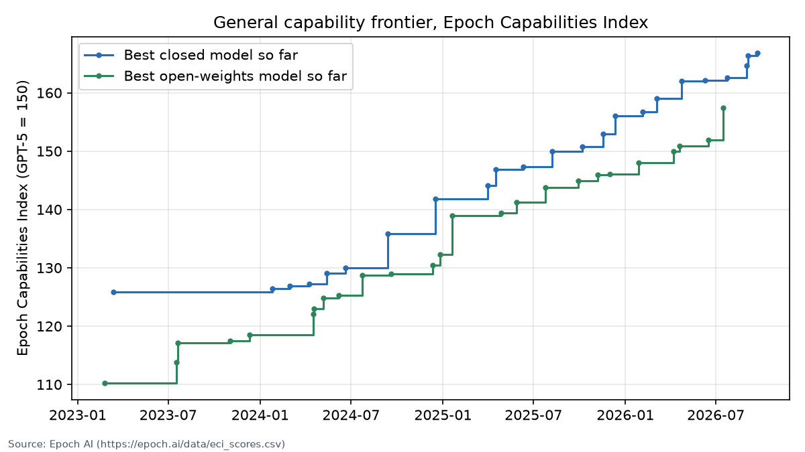

# AGI Tracker

**How close are we to artificial general intelligence? This site answers with a precise definition, five measurable tests, and dated evidence from primary sources.**

*Last full review: 15 October 2026*

---

## What AGI means here

> **AGI is an AI system that can learn and do nearly all the cognitive work that skilled humans do, including work it was never trained for. It does this on its own, as reliably as those humans, and at no greater cost.**

AGI is reached when one system passes all **five tests**:

| Test | Asks | Status (Oct 2026) |
|---|---|---|
| **T1 Breadth** | Expert level across almost all kinds of cognitive work? | 🟡 Partly |
| **T2 Learning new things** | Learns a brand-new skill as efficiently as a person? | 🟡 Partly, moving fast |
| **T3 Long tasks alone** | Finishes month-long projects with no help, 80% of the time? | 🔴 Not met (3.1 h of 167 h) |
| **T4 Learning on the job** | Gets better from experience and keeps it? | 🔴 Not met |
| **T5 Reliable and affordable** | As trustworthy and as cheap as the human? | 🔴 Not met |

**Verdict: not AGI yet.** The fastest-moving test is T2: ARC-AGI-3 went from below 1% to 62.7% in six months. The hardest walls are long tasks at high reliability (T3) and learning on the job (T4).

[Why this definition, and how it compares with eight others →](definition.md)

---

## Progress in two charts

**Long tasks (T3).** The length of task, measured in human-expert time, that AI agents can finish. It doubles about every 129 days. Source: METR.

**General capability (T1).** The best closed and open models on Epoch AI's capability index. Open models trail by about 9 points, roughly half a year.

---

## Read

| Page | What you get |
|---|---|
| [**What is AGI?**](definition.md) | The definition, the five tests with their pass lines, and nine definitions compared |
| [**Tracker**](tracker.md) | The status of each test, with dated, sourced numbers |
| [**Survey**](survey.md) | The state of the field in 12 areas, from scaling and reasoning to memory, robots and safety |
| [**Timeline**](timeline.md) | Milestones from 1950 to today |
| [**Learn**](learn/index.md) | A 12-module study path from foundations to the frontier, with readings, tasks and self-checks |
| [**Ideas**](ideas.md) | Open problems, each with what would count as progress |

**Sources.** Numbers come from primary sources (ARC Prize, METR, Epoch AI and the benchmark papers). Every number carries a date and its setting, and aggregator figures are marked UNVERIFIED. The raw data and the scripts that rebuild these charts are on [GitHub](https://github.com/thesvj/agi-tracker).
