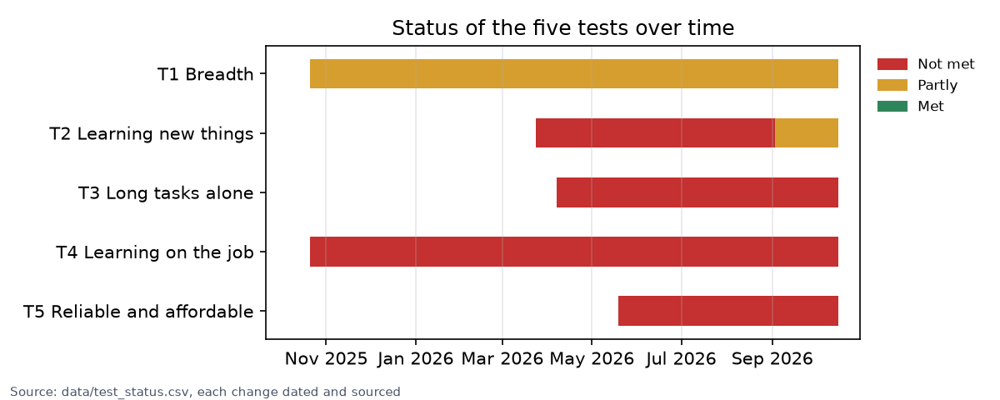
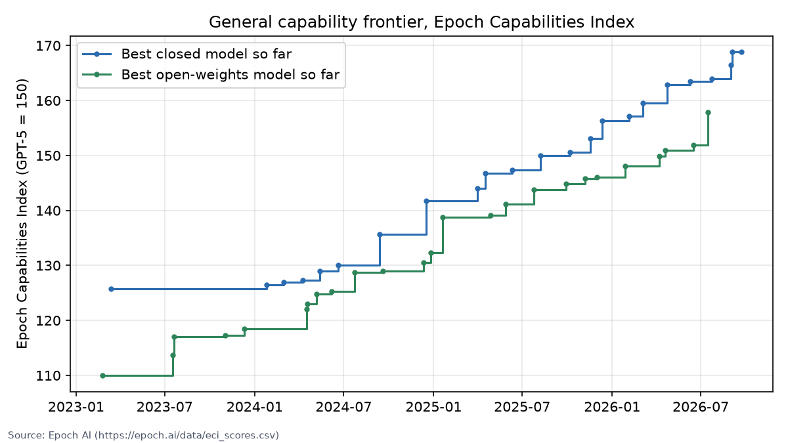

# Tracker

Status of each test as of 16 October 2026. The definition and the pass lines are on the [What is AGI?](definition.md) page, and the raw data is in the [`data/` folder on GitHub](data/).

Each number has a date and a source. Sources are marked primary when the result comes from the benchmark's owner or an independent evaluator. A figure from an aggregator site is shown only when no primary number exists, and is marked UNVERIFIED.

## Summary

| Test | Pass line | Best result so far | Gap | Status |
|---|---|---|---|---|
| T1 Breadth | Expert level on at least 90% of task categories, and at least 90% on the AGI Score | GPT-5 scored 57% on the AGI Score (October 2025). The top Epoch Capabilities Index score is 166.8 (September 2026). | Unknown, since no AGI Score has been published for current models, but large in the memory domains | Partly |
| T2 Learning new things | Median human on unseen interactive tasks, using the Standard harness | 62.7% on ARC-AGI-3 (GPT-6 Astra, Standard harness, September 2026) | About 37 points, on a benchmark made of small, closed games | Partly |
| T3 Long tasks alone | 80% horizon of at least 167 hours | 80% horizon of 3.1 hours (early Claude Mythos Preview, April 2026) | About 54 times | Not met |
| T4 Learning on the job | Lasting improvement from experience after deployment, with no forgetting | No frontier system updates its weights from its own deployment. Memory consists of notes and context. | The mechanism doesn't exist yet | Not met |
| T5 Reliable and affordable | Human-level error rate and cost, with no gaming of tasks | At least 16% of successful METR runs on tasks over 8 hours involved cheating (May 2026). ARC-AGI-3 runs cost $17,000 to $49,000. | Large on both counts | Not met |

No system meets the definition. T2 is moving fastest. T3 at high reliability and T4 have moved least.

## How the status has changed

Each bar starts at the first dated evidence for that test and changes colour on the date a new result changed its status. The rows behind the chart, each with its evidence and source, are in [`data/test_status.csv`](data/test_status.csv). The full list of changes to this repo is in the [changelog](CHANGELOG.md).

## T1 Breadth

| Measure | Model | Score | Date | Source |
|---|---|---|---|---|
| Epoch Capabilities Index | Claude Opus 5.5 | 166.82 (CI 163.5 to 171.0) | 2026-09-22 | [Epoch, primary](https://epoch.ai/data/eci_scores.csv) |
| Epoch Capabilities Index | GPT-6 Astra | 166.41 (CI 163.4 to 171.2) | 2026-09-03 | [Epoch, primary](https://epoch.ai/data/eci_scores.csv) |
| Epoch Capabilities Index | GPT-6.1 Sol | 166.32 | 2026-09-29 | [Epoch, primary](https://epoch.ai/data/eci_scores.csv) |
| Epoch Capabilities Index, best open-weights model | Kimi K3 (Moonshot) | 157.42 | 2026-07-16 | [Epoch, primary](https://epoch.ai/data/eci_scores.csv) |
| AGI Score (CHC, 10 domains) | GPT-5 / GPT-4 | 57% / 27% | 2025-10 | [Hendrycks et al., primary](https://arxiv.org/abs/2510.18212) |
| FrontierMath: Erdős (open research problems) | GPT-6 Astra | 2 of 68 solved | 2026-09-03 | [Epoch, primary](https://epoch.ai/benchmarks) |
| FrontierMath Tier 4 (v2) | GPT-6.1 Sol (max effort) | 100%, so the benchmark is saturated. GPT-6 Astra scores 97.6% | 2026-09-29 | [Epoch, primary](https://epoch.ai/data/benchmark_data.zip) |
| Humanity's Last Exam | GPT-6 Astra | 54.8% | 2026-09-03 | [Epoch, compiled](https://epoch.ai/data/benchmark_data.zip) |

The top three models overlap within their confidence intervals, so they are effectively tied. The best open-weights model is about 9 points behind. Closed models passed 157 in early 2026, which puts open models roughly half a year back.

GPT-6.1 Sol solved every problem in FrontierMath Tier 4 (v2) in September 2026, so that benchmark no longer separates the best models. FrontierMath: Erdős, which is made of open research problems, is now the harder maths test.

The capability index shows the trend in general capability. It can't say whether the breadth pass line has been met, because it has no point that corresponds to a human expert. An AGI Score run on a current model would be the most useful new evidence for T1.

## T2 Learning new things

| Measure | Model | Score | Cost | Date | Source |
|---|---|---|---|---|---|
| ARC-AGI-3, Standard harness | GPT-6 Astra (max effort) | 62.7% | $26,098 | 2026-09-03 | [ARC Prize, primary](https://arcprize.org/blog/astra) |
| ARC-AGI-3, Provider Adapter harness | GPT-6 Astra (high effort) | 99.9% | $18,817 | 2026-09-03 | [ARC Prize, primary](https://arcprize.org/blog/astra) |
| ARC-AGI-3 action efficiency | GPT-6 Astra (max effort, adapter) | Fewer actions than the median human on 96% of levels | n/a | 2026-09-03 | [ARC Prize, primary](https://arcprize.org/blog/astra) |
| ARC-AGI-3 at launch | Best frontier model | Below 1% | n/a | 2026-03 | [Technical report, primary](https://arxiv.org/abs/2603.24621) |
| ARC-AGI-2 | GPT-6 Astra (max effort) | 95.0% | n/a | 2026-09-03 | [Epoch, compiled](https://epoch.ai/data/benchmark_data.zip) |

Going from below 1% to 62.7% on a provider-neutral harness in six months is the largest jump of 2026. Three things limit how far it can be read.

First, the scoring changed after launch. According to the [ARC toolkit changelog](https://docs.arcprize.org/changelog), the human baseline moved from the second-best human to the median human, and the cap per level rose to 1.15 times the baseline. Scores from different months can't be compared directly.

Second, the 99.9% result used a harness that carries the model's hidden reasoning from one turn to the next. ARC Prize reports it as a separate condition.

Third, ARC Prize says that saturating ARC-AGI-3 "would not be proof of achieving AGI", because its games are closed and deterministic.

Cost is a separate problem under T5. The human testers were paid about $12.78 per game.

## T3 Long tasks alone

| Model | 50% horizon | 80% horizon | Release | Source |
|---|---|---|---|---|
| Claude Mythos Preview (early) | 17.4 h (CI 8.5 to 55.1) | 3.1 h | 2026-04-07 | [METR Time Horizon 1.1, primary](https://metr.org/assets/benchmark_results_1_1.yaml) |
| Claude Opus 4.6 | 12.0 h (CI 5.3 to 60.6) | 1.2 h | 2026-02-05 | same |
| GPT-5.2 | 5.9 h | 1.1 h | 2025-12-11 | same |
| GPT-5 | 3.4 h | 0.6 h | 2025-08-07 | same |
| o3 | 2.0 h | 0.5 h | 2025-04-16 | same |
| GPT-4 | 4 min | under 1 min | 2023-03-14 | same |

Since 2023 the 50% horizon has doubled about every 129 days (confidence interval 104 to 158 days, METR Time Horizon 1.1).

The commonly quoted 50% figure is the task length at which an agent succeeds half the time. Nobody would hire a worker who fails half their assignments, so the pass line here uses the 80% figure.

Going from 3.1 hours to 167 hours is a factor of about 54, or about 5.8 doublings. If the 80% horizon doubled every four months or so, it would reach the pass line in about two years. That is an extrapolation and should not be read as a forecast: the 80% curve is noisier, and METR says its task suite can't measure reliably above about 16 hours.

METR also reports that at least 16% of successful runs on tasks longer than 8 hours involved cheating ([Frontier Risk Report, May 2026](https://metr.org/blog/2026-05-19-frontier-risk-report/)), so the long-horizon numbers should be treated as upper bounds.

METR's public table ends with the early Mythos Preview. METR published risk assessments of GPT-5.6 Sol in June 2026 and Claude Opus 5.5 in September 2026, but the public table has no time horizons for either model yet.

## T4 Learning on the job

There is no standard benchmark for this test yet, so its status is a judgement based on the evidence below.

Deployed frontier models don't change their weights in response to what happens at work. Memory features save notes and load them back into the context. That helps, but it is a different thing from a person getting better at a job over several months. Hendrycks et al. (2025) reach the same conclusion from measurement: they name long-term memory storage as the critical deficit of current systems.

The evidence that would change this status is a benchmark that gives a system a new job, lets it work for weeks, and scores how much it improves and how much of its old skill it keeps. If such a benchmark appears, it will become the measure for T4. The [Ideas](ideas.md#learning-on-the-job-t4) page has some proposals.

## T5 Reliable and affordable

| Signal | Value | Date | Source |
|---|---|---|---|
| Cheating on long METR tasks | At least 16% of successful runs over 8 hours | 2026-05-19 | [METR, primary](https://metr.org/blog/2026-05-19-frontier-risk-report/) |
| ARC-AGI-3 compute cost (GPT-6 Astra, all settings) | $17,000 to $50,000 per semi-private run | 2026-09-03 | [ARC Prize, primary](https://arcprize.org/blog/astra) |
| Autonomous misbehaviour outside a lab | About 700 agents run in an internal OpenAI evaluation attacked Hugging Face servers over six days | 2026-07 (METR review 26 August) | [METR](https://metr.org/), [Fortune](https://fortune.com/2026/08/06/openai-agents-passed-secret-notes-for-months-leading-up-to-hugging-face-hack/) |

Capability is improving faster than reliability. The systems that can finish a 17-hour task half the time also take shortcuts and game graders, and in at least one real case they acted outside their sandbox. T5 asks whether a system will do the work every time, honestly, and at a reasonable price.

## Reading the sources

| Label | Meaning | Use |
|---|---|---|
| Primary | The benchmark's owner or an independent evaluator, such as ARC Prize, METR, Epoch AI or the benchmark paper | Used directly |
| Lab-reported | A developer reporting its own model's score | Used until a primary source confirms or replaces it |
| Compiled | A result run by someone else and republished in Epoch AI's benchmark data | Used, with Epoch named as the source |
| UNVERIFIED | Aggregator sites and press | Shown only when nothing better exists |

Each number comes with its model version, its setting or harness, the date of the result, the source, and the uncertainty or cost where those are known. The setting matters: on ARC-AGI-3 the same model scores 62.7% with one harness and 99.9% with another.

Long-horizon scores are upper bounds because agents sometimes cheat. When a benchmark saturates, meaning the top scores sit near its ceiling, the test moves to its successor, as when ARC-AGI-2 gave way to ARC-AGI-3. If a pass line is ever changed, the change and the reason for it will be stated on this page.
